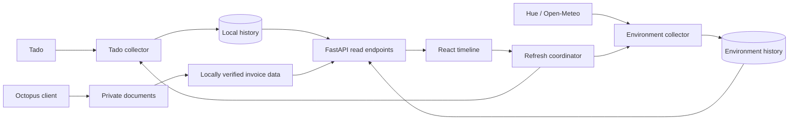

# Architecture

Casa is a local application with independent collectors and a read-oriented web API.
This organization separates source ownership without changing installed storage locations.



The diagram's document-to-verified-data step is manual: there is no automatic PDF parser or scheduled
Octopus import. The browser never receives provider credentials. GET endpoints read local data;
`POST /api/refresh` can delegate bounded work to installed collectors after same-origin validation.

## Source layout

```text
backend/                  Python runtime package
web/src/features/         UI by domain
web/src/lib/              Shared browser contracts and lifecycle
scripts/macos/            Platform installers and wake helper
scripts/check_publication.py
tests/                    Synthetic regression tests
examples/                 Empty configuration examples
docs/                     Architecture, setup and privacy
```

## Dependencies and persistence

Collectors own writes to their stores. `web_server` queries SQLite read-only and delegates pure
session calculations to `heating_sessions`. `refresh_coordinator` launches only fixed installed
commands and persists attempt limits independently of browser lifetime. `octopus_api` remains an
explicit CLI integration; importing it does not authenticate or download anything.

Each store has a single writer lock, bounded growth and failure preservation. Schema evolution must
include a migration, a rollback/recovery strategy and compatibility with installed services. A copied
source file is not a migration. Do not move runtime data simply because source directories move.

## Domain invariants

- Union of room demand counts simultaneous requests once; it does not measure gas or confirm flame.
- Unknown/disconnected intervals stay unknown. Partial session boundaries remain explicit.
- Temperature changes retain original sample timing and coverage requirements.
- Invoice totals and synthetic estimates have distinct provenance. Fixed charges are not avoided
  by switching off an individual session.
- Refreshing data must not reset gestures or historical viewports.

## Extension strategy

Add a concrete provider at the collection boundary first: define local fields, provenance, units,
freshness, quota and error semantics. Add synthetic contract tests, then a read endpoint and feature
UI if needed. Extract shared abstractions when at least two implementations need the same contract.

The present modules are intentionally small in number. If `web_server` grows, separate routers by
resource while preserving response contracts. If weather and Hue grow independently, split their
collectors while retaining independent write coordination. Do not introduce new services or a message
bus until their operational cost is justified by an actual requirement.

Ventilation is a pure historical detector with optional context. Feedback writes to a separate,
bounded insights database; the climate history remains read-only to the web. Guided calibration is
an explicit CLI session, never a page-open side effect. It shares collector locking/quota and has a
persisted deadline. See [ventilation](ventilation.md) for contracts and rollback.
